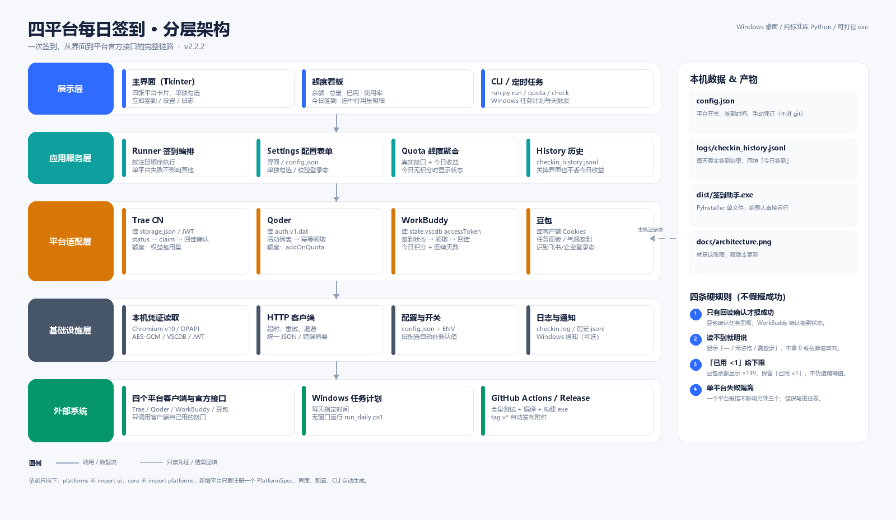

# 架构



> 图由 `scripts/draw_architecture.py` 生成（Pillow + 系统字体，中文不会乱码）；改代码后重跑脚本即可更新。
> 原理、封号风险与开源项目对比见 `docs/PRINCIPLES_AND_COMPARISON.md`。

## 分层

```
ui / cli                入口层，只负责"问用户要什么、把结果说人话"
   ↓
services (runner/quota/history/settings)   编排与纯逻辑：跑哪些平台、额度汇总、签到历史、表单 ↔ 配置
   ↓
platforms (base/registry/*)  插件层：每个平台的端点、请求、判定、登录态探测
   ↓
core (models/http/config/secrets/aesgcm/...)  基础设施
```

依赖只向下，不向上：`platforms` 不 import `ui`，`core` 不 import `platforms`（`config` 只读注册表来生成默认值）。

## 为什么这样切

- **core**：所有平台共用。`secrets.py` 负责 DPAPI + `v10` 解密 + `state.vscdb` 读取；
  `aesgcm.py` 是纯 Python 的 AES-256-GCM（只解密），避免为一个功能强制装 cryptography。
- **platforms**：一个平台一个文件，文件里只有"接口长什么样、怎么判成败、怎么判断已登录"。
  注册表把它们收集起来，其它层只看注册表。
- **services**：`runner` 决定执行顺序、重试、结果汇总；`settings` 是界面与配置之间的纯函数，
  不碰 tkinter，因此可以纯单测覆盖。
- **ui**：面板完全由 `PlatformSpec` 生成，没有写死任何一个平台的控件。

## 一次签到的数据流

```
UI「立即签到」/ 计划任务
   → runner.run_all(cfg, only, dry_run)
       → 对每个启用的 spec
           → spec.run(client, section)        平台自己发请求
               → section 里没有凭证时，先 spec.login_state() 自动读本机登录态
           → CheckinResult(status, credits, message)
   → summary() 出表格 + 退出码
```

UI 里跑在后台线程，结果通过 `queue` 回主线程刷新，不阻塞窗口。

## 额度看板数据流

```
UI「额度看板」/ `run.py quota`
   → quota.collect(cfg, client, results=今天的签到结果)
       → 对每个 spec 调 spec.quota(client, section)
           → Qoder / Trae / WorkBuddy / 豆包各自的只读用量接口
           → WorkBuddy 额外读 checkin-activity-status（今日积分、连续天数）
       → QuotaSnapshot(balance, total, used, percent, today_earned, today_text, details)
   → 表格 + 选中平台的用量明细
```

- 额度查询是**只读**的，不签到、不改平台数据。
- `today_earned` 只从当天真实的 `CheckinResult`（OK / ALREADY 且带 credits）合并；活动奖励不是账户余额。
- `today_text` 用于“没有具体金额但有明确状态”的情况：`无资格 / 已签 / 需登录 / 失败`。
  `fmt_today()` 的优先级是“真实金额 `+N` → `today_text` → `—`”。
- `quota.collect` 的映射：`OK/ALREADY + credits` → `today_earned`；`OK/ALREADY` 无 credits → `已签`；
  `SKIPPED + detail.no_activity` → `无资格`；`NEED_SETUP` → `需登录`；`FAILED` → `失败`。
- 平台只返回“已用 `<1`”时，`balance` 保持 `None`，另给 `balance_text` 下限（如 `≥199`），不伪造精确值。
- UI 打开时先读 `logs\checkin_history.jsonl` 里今天的结果，再用当前界面结果覆盖，关掉界面也不会丢今天的收益。
- 某个平台没返回的字段写 `None`，界面显示「—」，绝不用默认 0 或估算值。

## 登录态（核心设计）

`LoginState(ok, account, message, data)` 是平台"自己报告"的探针结果：

- `ok`：读到可用凭证，`data["token"]` 可直接用
- `account`：人类可读的身份（昵称 / 邮箱 / uid），显示在界面「登录状态」区
- `message`：读不到时的原因，直接给用户看

`PlatformSpec.detect_login()` 会把任何异常转成 `LoginState(False, message=...)`，
所以"读登录态"这一步永远不会把界面或定时任务弄崩。

凭证来源（本机实测）：

| 平台 | 位置 | 加密 | 读取方式 |
|---|---|---|---|
| Qoder | `%APPDATA%\com.qodercn.app.stable\auth.v1.dat` | `v10` = AES-256-GCM，密钥在 `Local State` 的 `os_crypt.encrypted_key`，先 DPAPI 解一层 | `secrets.read_encrypted_json()` |
| WorkBuddy | `%APPDATA%\CodeBuddy CN\User\globalStorage\state.vscdb`（SQLite，ItemTable） | 同上；值可能是 TEXT 形式的 `{"type":"Buffer","data":[...]}` | `secrets.read_vscdb_secret()` |
| Trae CN | `%APPDATA%\<Trae 应用>\User\globalStorage\storage.json` 的 `iCubeAuthInfo://icube.cloudide` | 自定义信封：sha512 派生 + AES-128-CBC，前 64 字节是明文 sha512 校验 | `trae.decrypt_storage_value()` |
| 豆包 | `%LOCALAPPDATA%\Doubao\User Data\Profile 3\Network\Cookies`（可能多个 Profile，逐个探测有 Cookie 的） | `v10` = AES-256-GCM，密钥在对应 Profile 的 `Local State` | `secrets.decrypt_blob()` + `doubao.login_state()`；识别 `feishu_dpop_keypair` / `LARK_SUITE_ACCESS_TOKEN` 判断飞书/企业登录态 |

> 豆包飞书/企业登录态没有个人版每日签到资格：`landing/checkin` 回 `710010702`，
> 奖励接口的 `biz_error.code=3` 只是“确认中”的壳，不会真的到账。`_run_work_account()` 只探一次就返回 `SKIPPED`，
> 消息里给出上次成功签到日期和换个人账号的方法；额度看板显示「无资格」。
>
> WorkBuddy 签到后回读 `checkin-activity-status` 的 `today_checked_in`：状态读不到或仍为 `false` 时不报 `OK`；
> 状态为 `true` 时用 `today_credit` / `daily_credit` 填 `today_earned`，并记录 `streak_days`。

## 配置

`config.DEFAULTS` 由注册表生成：每个 `FieldSpec` 一条配置键，`PlatformSpec.defaults` 补上不上界面的键。
`ENV_MAP` 同样由 `FieldSpec.env` 推导，凭证类字段命中环境变量时自动启用该平台。

`config.load()` 与默认值深合并，所以旧配置（缺字段）不会报错，新字段自动补默认值。
